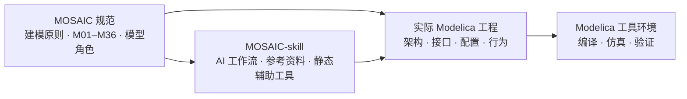

<p align="center">
  
</p>

<h1 align="center">MOSAIC</h1>
<p align="center"><strong>Modelica-Oriented System Architecture, Interfaces and Contracts</strong><br>
面向 Modelica 的总体级系统架构、接口与契约建模规范</p>
<p align="center"><em>Model the Whole as MOSAIC.</em></p>

<p align="center">
  <a href="./MOSAIC_v0.8_Modelica_Modeling_Standard.html">📘 中文完整规范 · v0.8</a>
  &nbsp;·&nbsp;
  <a href="https://github.com/Ruizhe-Yang/modelica-system-level-simulation-skill">🛠️ MOSAIC-skill · AI 辅助实施</a>
  &nbsp;·&nbsp;
  <a href="#english-documentation">English Introduction</a>
</p>

**MOSAIC** 面向复杂系统的 Modelica 总体级建模与多物理场仿真，提供一套能够落实到具体模型、接口、参数、图形和验证工作的工程规范。它从真实系统的组成和工作关系出发，统一约定**模型角色、结构与行为分工、接口契约、配置来源、模型可视化以及仿真证据**，帮助工程师建立可理解、可配置、可扩展、可维护的系统模型。

> **English overview:** MOSAIC is a practical modeling methodology and engineering specification for **system-level, multi-physics modeling with Modelica**. It defines how to organize system architecture, assign behavior to components, manage interfaces and configuration, and maintain traceable simulation evidence. The companion [MOSAIC-skill](https://github.com/Ruizhe-Yang/modelica-system-level-simulation-skill) helps AI coding agents apply these conventions to real projects. MOSAIC is **not** a simulation solver or an additional Modelica runtime library.

## 从哪里开始？

| 你的目标 | 推荐入口 |
|---|---|
| 了解 MOSAIC 的完整规则与设计思想 | **[阅读 MOSAIC v0.8 中文建模规范（HTML）](./MOSAIC_v0.8_Modelica_Modeling_Standard.html)** |
| 在已有 Modelica 工程中检查架构、接口、文档或图形 | **[使用 MOSAIC-skill](https://github.com/Ruizhe-Yang/modelica-system-level-simulation-skill)** 的审查与限定维护模式 |
| 新建总体级仿真项目 | 先确定系统边界、模型角色、配置和验收指标，再参照规范建模；可选用 MOSAIC-skill 辅助实施 |
| 了解规范和 AI 技能的区别 | 阅读下方“**MOSAIC 与 MOSAIC-skill**” |

本仓库目前以**中文 HTML 规范**为主要交付物。打开上方文件链接后，可在 GitHub 页面下载原始 HTML，再用浏览器本地阅读；规范包含条文、分类说明与相关参考内容。

## 解决什么工程问题？

大型 Modelica 项目经常面临系统层级与物理计算混杂、接口语义不清、参数来源分散、画布与实际连接不一致，以及模型迭代后难以复用既有工作等问题。MOSAIC 把这些问题转化为可以逐项检查的建模约定：

- **架构清晰：** 用真实系统、分系统、装配和行为单元组织模型，让 Diagram 反映实际实例和连接。
- **职责明确：** 区分只负责组织与连接的白箱，以及承担物理方程、控制算法和状态的行为单元。
- **接口可信：** 优先复用 Modelica Standard Library（MSL）的接口语义，明确能量、物质、机械、热、电和信号交互。
- **配置同源：** 明确参数、曲线、单位和初态的权威来源；允许从 Excel 等设计表离线生成最终 Modelica 源码，运行时不依赖办公软件。
- **图形可用：** 使 Icon、Diagram、Placement 与真实端口、`connect` 对应，区分 MSL 原生接口线色与自定义接口线色。
- **验证有据：** 区分静态审查、编译、初始化、完整任务仿真、结果校核和模型保真度评估，不以其中一项代替全部。

## 核心建模框架：五种模型角色

MOSAIC 使用五种**职责角色**组织可执行系统模型。它们是建模概念，**不要求在实际类名中添加 TB/SB/AB/BU/LU 前缀**。

| 角色 | 定位 | 主要责任 |
|---|---|---|
| **TB — Top-level Box** | 顶层盒 · 白箱 | 定义完整仿真入口、实验构型、系统/环境实例及静态连接 |
| **SB — System Box** | 系统盒 · 白箱 | 组织真实系统或分系统的集成边界、公开接口及内部组成 |
| **AB — Assembly Box** | 装配盒 · 白箱 | 在末级组合 BU/LU，建立必要的静态连接与装配边界 |
| **BU — Behavior Unit** | 行为单元 · 黑箱 | 实现内聚的物理方程、控制算法、状态与初始化 |
| **LU — Library Unit** | 库复用单元 · 黑箱 | 复用 MSL 原生组件或未改变行为的静态/展示别名 |

**关键约定：TB、SB、AB 的本层只承担声明、静态配置和连接；本构、控制与状态演化由明确的 BU/LU 承担。** 具体继承、修饰、初始化、嵌套和允许的连接模板，以完整规范中的角色清单为准。

## v0.8 规范包含什么？

当前版本提供 **M01—M36 共 36 项主条文**，分为 **26 项必须（R）、9 项建议（S）和 1 项参考（F）**，另有专题参考与实施说明。主要覆盖：

| 主题 | 规范重点 |
|---|---|
| 系统架构与模型角色 | 真实组成、统一执行网络、五类角色、白箱与行为边界 |
| 多物理场接口与状态 | 连接器语义、MSL 复用、信号身份、单位、状态拥有者 |
| 参数配置与工程结构 | 设计配置、曲线数据、离线生成、依赖与版本一致性 |
| 图形、文档与品牌 | 原生 Diagram、功能 Icon、连线颜色、类说明与文档规则 |
| 仿真验证与模型演进 | 编译运行、证据边界、结果诊断、变更保护与工程交付 |

工程默认基于项目自有 Modelica 源码和 **MSL 4.0.0**；对于已有工程，遵守其已冻结的有效依赖版本，不因阅读本规范而自动升级。规范适用于航天器、航空器、燃气轮机及其他需要总体级多物理场建模的对象，但不预设所有行业采用相同的系统划分、参数或物理模型。

## MOSAIC 与 MOSAIC-skill

两者属于**同一方法体系的两个层次**：一个定义工程规则，一个辅助执行工程规则。



| 项目 | [MOSAIC（本仓库）](https://github.com/Ruizhe-Yang/MOSAIC) | [MOSAIC-skill](https://github.com/Ruizhe-Yang/modelica-system-level-simulation-skill) |
|---|---|---|
| 定位 | 总体建模方法及中文规范 | 面向 AI 编程助手的规范实施技能 |
| 核心内容 | 完整 HTML 条文、角色与接口要求、图形和文档约定 | `SKILL.md`、按任务加载的参考资料、检查脚本、示例与测试 |
| 主要使用者 | 系统建模师、总体设计师、研究人员 | 使用 Codex 或兼容 Agent Skills 宿主开展 Modelica 工程工作的人员 |
| 是否负责数值求解 | 否 | 否；需要已安装的实际 Modelica 工具和明确的执行任务 |

**可以只用 MOSAIC 规范人工建模；使用 MOSAIC-skill 时，则应将本仓库的同版本规范作为方法依据。** Skill 不会自动替代工程师的设计判断，也不保证只靠静态检查即可获得正确的物理仿真结果。

## 推荐的工程工作流

1. **定义任务：** 确认总体模型用途、真实系统边界、运行场景、关键指标和约束条件。
2. **组织结构：** 分配 TB/SB/AB/BU/LU 角色，先确定真实组成和职责，再确定图形布局。
3. **建立接口：** 优先复用合适的 MSL 接口，明确自定义接口、单位、信号和状态归属。
4. **准备配置：** 管理设计表与曲线的来源，生成可独立加载的 Modelica 工程及确定的生效参数。
5. **形成闭环：** 在真实 Modelica 环境编译、初始化、仿真，检查原始结果、指标和必要的独立证据。
6. **受控演进：** 区分行为优化与纯文档/图形维护，保护已认可的运行基线，记录变更和剩余限制。

## 仓库内容与适用边界

```text
MOSAIC/
├── README.md
├── MOSAIC_v0.8_Modelica_Modeling_Standard.html  # 中文完整建模规范
└── assets/brand/
    ├── MOSAIC_logo.svg                       # 总品牌 LOGO
    └── MOSAIC_symbol.svg                     # 品牌符号
```

本仓库目前**不分发独立的 Modelica 运行库、求解器或完整案例仿真工程**。MOSAIC-skill 仓库提供一个 12UCubeSat 工程的**方法使用说明**，但也不随仓库附带该项目的完整模型及运行数据。将规范应用于实际工程时，物理实现、模型保真度、工具兼容性和验证结论需要分别确认。

欢迎通过 GitHub Issues 交流条文理解、实际建模经验、接口设计与规则改进建议。

---

<p align="center"><strong>Model the Whole as MOSAIC.</strong><br><sub>Architecture · Interfaces · Contracts · Executable Modelica Systems</sub></p>


---

<a id="english-documentation"></a>

# MOSAIC — English Introduction

**Modelica-Oriented System Architecture, Interfaces and Contracts**  
*Model the Whole as MOSAIC.*

MOSAIC is an **engineering modeling methodology and practical specification for system-level, multi-physics simulation with Modelica**. It helps modelers represent a complex engineered system through a coherent set of system boundaries, reusable components, explicit interfaces, configuration records, and executable behaviors. Its purpose is to make system models easier to **understand, assemble, configure, inspect, evolve, and verify** as the engineering project grows.

Rather than introducing a new solver or requiring an additional Modelica component library, MOSAIC defines **how to organize and maintain an existing Modelica engineering project**. The current specification is **MOSAIC v0.8**.

**Useful links:** [Full MOSAIC v0.8 modeling specification (Chinese HTML)](./MOSAIC_v0.8_Modelica_Modeling_Standard.html) · [MOSAIC-skill — AI-assisted implementation](https://github.com/Ruizhe-Yang/modelica-system-level-simulation-skill) · [OneSatSim — MOSAIC-based spacecraft example](https://github.com/Ruizhe-Yang/OneSatSim)

## Why MOSAIC?

Building a large Modelica model involves more than writing physical equations. System engineers must also decide where the system boundaries lie, which components own dynamic states, how interfaces carry physical or information signals, how design parameters reach the running model, and how a change can be verified without unintentionally altering established behavior.

MOSAIC addresses these recurring engineering concerns:

- **Architecture that reflects the system:** organize real systems, subsystems, assemblies, and behavioral units into a navigable model hierarchy.
- **Clear division of responsibilities:** distinguish white-box composition from physical, control, or algorithmic behavior.
- **Explicit interfaces and contracts:** preserve connector semantics, units, signal identities, and state ownership across model boundaries.
- **Single-source configuration:** manage design parameters, curves, initial conditions, and generated Modelica records without competing defaults.
- **Useful native diagrams:** make Modelica `Icon`, `Diagram`, `Placement`, and actual `connect` statements mutually consistent.
- **Traceable verification:** distinguish source-level checks from compilation, initialization, mission simulation, result validation, and fidelity assessment.

These practices are intended for multi-domain systems such as spacecraft, aircraft, gas turbines, and other complex engineering applications. They do not impose one universal physical architecture or a fixed level of model fidelity.

## Five model roles

MOSAIC defines five conceptual **model roles**. They describe responsibilities, not mandatory naming prefixes.

| Role | Meaning | Main responsibility |
|---|---|---|
| **TB — Top-level Box** | Top-level white box | Defines the simulation entry, selected configuration, environment/system instances, and their connections. |
| **SB — System Box** | System/subsystem white box | Defines an integration boundary, public interfaces, internal composition, and static connections. |
| **AB — Assembly Box** | Assembly white box | Combines lower-level behavior/library units through a meaningful assembly boundary. |
| **BU — Behavior Unit** | Behavioral black box | Implements coherent physical equations, control logic, algorithms, state variables, and initialization. |
| **LU — Library Unit** | Library reuse black box | Reuses native Modelica Standard Library components or static/display-only aliases without adding new behavior. |

**Core rule:** TB, SB, and AB have *composition-only responsibilities at their own level*: declarations, static configuration, and connections. Physical constitutive equations, control logic, and state evolution belong to explicitly responsible BU/LU components. Detailed cases involving inheritance, modifiers, and statically expandable connection templates are covered by the complete specification.

Natural class names such as `CompleteMission` or `SpacecraftSystem` are preferred; `TB_`, `SB_`, `AB_`, `BU_`, and `LU_` prefixes are **not required**.

## What is included in v0.8?

The current specification contains **36 primary rules, M01–M36**: **26 required (R), 9 recommended (S), and 1 reference (F)**. Additional appendices provide implementation guidance for model roles, interfaces, Modelica visualization, documentation, and engineering workflows.

| Area | Covered engineering practices |
|---|---|
| Architecture and roles | Real component hierarchy, single executable network, model classification, and white-box/behavior boundaries |
| Interfaces and states | Standard-library connector semantics, custom interfaces, units, commands versus measurements, and state ownership |
| Configuration | Design parameters, physical properties, curves, offline generation, effective snapshots, and dependency tracking |
| Diagrams and documentation | Consistent `Icon`/`Diagram` representations, connection colors, class descriptions, and model navigation |
| Validation and maintenance | Scope-controlled changes, actual solver evidence, results interpretation, model evolution, and delivery checks |

The standard engineering baseline uses **project-owned Modelica source code and Modelica Standard Library (MSL) 4.0.0**. Existing projects with a validated, frozen dependency version should not be upgraded merely because they adopt a newer document.

## Recommended modeling workflow

1. **Define the engineering problem:** intended use, system boundaries, mission or operating scenarios, important outputs, and acceptance criteria.
2. **Establish the architecture:** identify actual systems and components, and assign appropriate TB/SB/AB/BU/LU responsibilities.
3. **Design interfaces:** choose suitable MSL connectors wherever possible, and specify custom interfaces and signal meanings explicitly.
4. **Establish one configuration source:** track parameter and curve provenance and generate self-contained Modelica configuration data when needed.
5. **Build and verify the executable system:** check the model, compile, initialize, simulate, and examine both raw results and independent engineering checks.
6. **Evolve the model deliberately:** separate behavior-changing work from documentation-only and visual-only changes, and preserve accepted baselines.

For example, an Excel workbook may be used **offline** to prepare configuration records. The resulting Modelica project can then run without reading that workbook during numerical integration.

## Specification, skill, and example project

The MOSAIC ecosystem separates the **engineering rules**, an **optional AI implementation aid**, and **real applications**:

| Project | Purpose | Entry point |
|---|---|---|
| **[MOSAIC](https://github.com/Ruizhe-Yang/MOSAIC)** (this repository) | Source of the engineering methodology and the full Chinese modeling standard | [MOSAIC v0.8 HTML](./MOSAIC_v0.8_Modelica_Modeling_Standard.html) |
| **[MOSAIC-skill](https://github.com/Ruizhe-Yang/modelica-system-level-simulation-skill)** | Agent Skill that helps AI coding assistants apply MOSAIC rules, audit projects, and protect task-specific change boundaries | [SKILL.md](https://github.com/Ruizhe-Yang/modelica-system-level-simulation-skill/blob/main/SKILL.md) |
| **[OneSatSim](https://github.com/Ruizhe-Yang/OneSatSim)** | A system-level, multi-physics **12U CubeSat** modeling and mission-simulation project implemented following MOSAIC conventions | [CompleteMission](https://github.com/Ruizhe-Yang/OneSatSim/blob/main/Simulation/CompleteMission.mo) |

MOSAIC can be adopted **manually**, without the skill. MOSAIC-skill helps execute and review modeling tasks but does **not** replace an actual Modelica compiler, simulation engine, or engineering validation.

## Repository contents and scope

```text
MOSAIC/
├── README.md
├── MOSAIC_v0.8_Modelica_Modeling_Standard.html  # Full Chinese standard
└── assets/brand/
    ├── MOSAIC_logo.svg                         # MOSAIC brand logo
    └── MOSAIC_symbol.svg                       # Brand symbol
```

The main deliverable in this repository is the **Chinese HTML specification**; download or open the HTML in a local browser for the full document. This repository does **not** distribute a separate Modelica solver, mandatory runtime library, or complete simulation case model.

MOSAIC is a modeling and engineering specification. Conformance to its structure alone does not establish numerical accuracy, safety certification, or fitness for a particular physical application. Model fidelity and validation results must be established for each engineering use case.

Issues and contributions discussing rules, system architectures, reusable interface practices, and real-world modeling experience are welcome.

<p align="center"><strong>Model the Whole as MOSAIC.</strong><br><sub>Open architecture · Explicit interfaces · Executable system models</sub></p>
